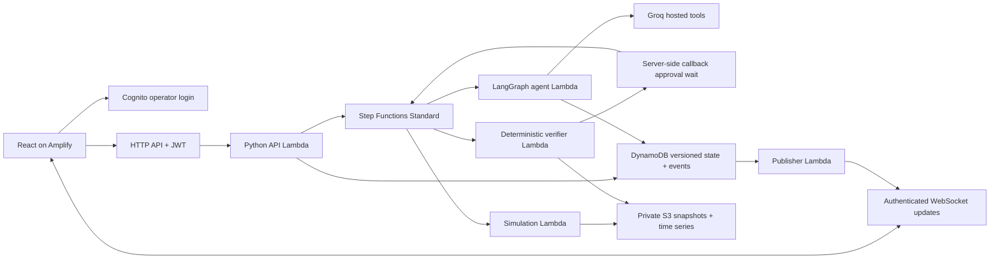

# AquaAgent

A working synthetic neighborhood water-resilience workspace with a deterministic Python water-balance engine, a React dashboard, bounded LangGraph investigation, operator approval, and an AWS CDK deployment definition.

Implementation began after the user confirmed the hackathon had opened on 9 October 2026. Source publication was authorized to https://github.com/paramshah2005/Varuna. Repository history uses genuine commit timestamps. Original project licensing remains pending the owner's choice.

## Run locally on Windows

Requirements: Python 3.12, uv, Node 22.12 or newer, npm, and Git. No local GPU or continuously running production server is required. Node 25.4 and Python 3.12 were used for the measured local verification; Amplify uses Node 22.

From the repository root:

```powershell
uv venv --python 3.12 .venv
uv pip install --python .venv/Scripts/python.exe -r backend/requirements.lock.txt
.venv/Scripts/python.exe -m backend.api.local
```

In a second terminal:

```powershell
cd frontend
npm ci
npm run dev
```

Open http://127.0.0.1:5173. The local API binds only to loopback and uses a clearly labelled local operator with SQLite and local JSON evidence. This development identity is never used by the deployed handler. Production identity comes exclusively from API Gateway JWT claims. Without provider configuration the agent mode is explicitly labelled deterministic fallback.

Local demonstration evidence lives in the ignored `.local/demo` directory. Set `LOCAL_ROOT` to a separate directory for isolated QA; changing that directory preserves earlier evidence rather than deleting it.

To use a Groq key locally, set `GROQ_API_KEY` in the backend process environment and `GROQ_MODEL=openai/gpt-oss-20b` before starting the API. Do not put a real key in source, a browser environment variable, scenario JSON, or a shell command shared with others. The current development session can hold a key only in process memory. Cloud jobs read the key from Secrets Manager; the Lambda environment contains only the secret name and model ID.

## Architecture



There are six consistent neighborhood zones, A–F. The water-transfer graph is abstract. The public walking graph is a separate seeded pedestrian graph. The eight fixtures and schema are in `data/`; benchmarks are in `docs/simulation-benchmarks.json`.

## Demo

1. Choose **Heatwave + supply disruption** and a 6-hour horizon. Initial forecast KPIs are empty; there is no simulation map.
2. Click **Run Simulation**. The workspace reveals and scrolls into view. The backend snapshots the exact scenario version and returns a run ID before the bounded jobs finish.
3. Inspect measured storage, demand/delivery, gross supply and shortage charts, anomaly candidates, rejected plans, zone requests/offers and the verified plan. Groq can produce six logical zone roles' proposals in up to two batched rounds, with actual trade feedback between rounds. Deterministic code coordinates transfers and verifies plans. Live, mixed and fallback negotiation have distinct labels; at most three completion attempts are allowed per run.
4. Approve the exact plan. The backend re-verifies it, simulates actions, verifies mass balance and critical service, and saves an evidence report.
5. Select a zone, change demand or storage, preview without changing applied data, apply a new version, and rerun. Earlier approval becomes invalid. Export/import schema-validated scenario JSON or reset the draft to the original fixture.
6. Open **Saved runs** to reopen persisted results. Open `/public` to choose a demo neighborhood and route to an eligible cooling center. Station closure is independent of zone supply.

## Verify

```powershell
.venv/Scripts/python.exe -m pytest -q
.venv/Scripts/python.exe -m scripts.generate_data
cd frontend
npm test
npm run build
npx playwright install chromium
npm run e2e
```

Playwright requires the local frontend and API to be running. It uses desktop and mobile projects. Fixture exports, model versions, per-zone/network balances, constraint failures, schema errors, ownership, idempotency, version isolation, durable graph restart, station filters, and independent pedestrian routing are tested. See `docs/VERIFICATION.md` for observed results and the boundary between local tests and cloud verification.

Browser tests edit applied scenarios. Run them against separate local storage and ports to preserve your demonstration session. Start an isolated API from the root in a separate terminal:

```powershell
$env:LOCAL_ROOT='.local/qa'
$env:AQUA_LOCAL_API_PORT='8001'
.venv/Scripts/python.exe -m backend.api.local
```

Start its frontend in another terminal:

```powershell
cd frontend
$env:AQUA_LOCAL_API_URL='http://127.0.0.1:8001'
npm run dev -- --port 5180 --strictPort
```

Then run the browser suite from a third terminal:

```powershell
cd frontend
$env:AQUA_E2E_BASE_URL='http://127.0.0.1:5180'
npm run e2e
```

A current verified run pauses for your decision. Use **Review response plan** to jump to its approval controls. If the applied scenario has changed, the workspace shows **Rerun required** and provides a button for the current applied version. Rerunning clears the draft-preview display but keeps draft inputs; unapplied edits are not part of the new run.

## Deploy and clean up

Follow `docs/DEPLOYMENT.md`. Infrastructure uses Cognito, API Gateway HTTP/WebSocket, seven Python Lambdas, Step Functions Standard, DynamoDB, private S3, an existing Secrets Manager secret, and CloudWatch logs/alarms. Git-connected Amplify Hosting serves the frontend. The deployment target defaults to `ap-southeast-2`; override it explicitly only when a different target is intended. No AWS resources have been created by local synthesis.

`cdk destroy` removes the stack-managed compute and hosting resources. DynamoDB, the S3 evidence bucket, and Cognito are retained deliberately. Delete retained resources separately only when their evidence and identities are no longer required. The existing Groq secret is never owned or deleted by this stack. Remove the Amplify Git connection if it is no longer needed. Stop local development processes separately.

## Model boundaries

This is a synthetic aggregate model, not a hydraulic solver or a trained demand predictor. Losses are deducted exactly once at their explicit denominator/location. Capacity never adds water; scheduled supply is bounded by separately configured available upstream supply and throughput. Storage is finite. Critical demand is included inside total demand. Repair duration and one-crew limits are assumptions, not proof of real-world repair effectiveness. Candidate fit scores are not probabilities. Forecast bands are scenario ranges. Public stations, coordinates, footfall and routes are synthetic; optional GPS is not retained. Environmental guidance is independent of allocation and does not diagnose illness.

See `docs/ACCOUNTING.md`, `docs/API.md`, `docs/AGENT_PERSISTENCE.md`, `docs/THIRD_PARTY.md`, `docs/RELEASE_READINESS.md`, and `docs/SUBMISSION.md` for consequential choices, credits, release boundaries, and AI-tool disclosure. Original project licensing remains the owner's decision; dependency licences must be preserved when distributing bundles.
